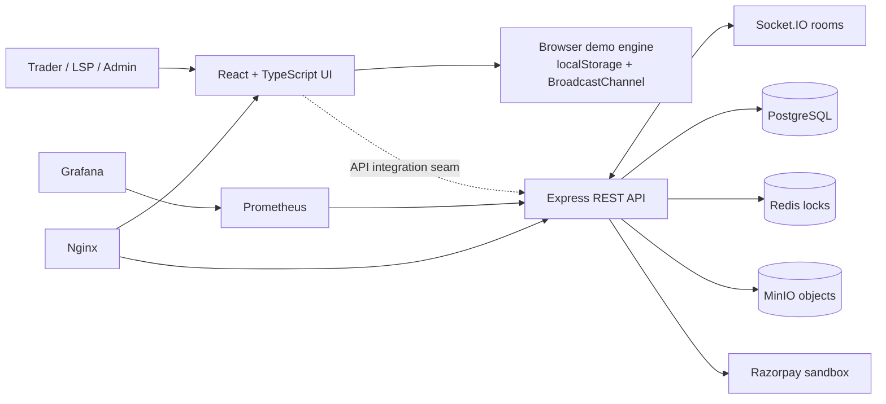

<div align="center">
  

# CargoShare

### Fill empty freight space. Move cargo for less.

An open-source, multi-modal marketplace that connects traders with verified logistics service providers offering spare capacity across **rail, road, sea, and air**.

[](https://github.com/Armaan-ui478/CargoShare/actions/workflows/ci.yml) [](LICENSE) [](https://react.dev/) [](https://www.typescriptlang.org/) [](CargoShare/docker-compose.yml)

[Overview](#overview) · [Features](#features) · [Quick start](#quick-start) · [Architecture](#architecture) · [API](#api) · [Contributing](#contributing)
</div>


## Overview

CargoShare helps exporters, importers, and logistics service providers make better use of partially filled freight movements. Traders can discover available capacity, compare routes and prices, reserve space, complete a sandbox checkout, and manage the shipment from one interface. LSPs can publish unused capacity and manage their inventory, while operators get approval, analytics, and dispute workflows.

The repository includes:

- a responsive React marketplace with trader, LSP, and admin experiences;
- a Node.js REST and Socket.IO API;
- PostgreSQL migrations and realistic seed data;
- Redis-backed, expiring booking locks to reduce double-booking risk;
- MinIO invoice and attachment storage;
- Docker Compose, Nginx, Kubernetes, Prometheus, and Grafana configuration.

> [!NOTE]
> The frontend currently runs as a self-contained demonstration using seeded browser data, `localStorage`, and `BroadcastChannel`. This makes every screen explorable without infrastructure. A production-style API is included in `CargoShare/server`, but the current UI store is not yet wired to it end to end.

## Features

| Experience | Included workflows |
| --- | --- |
| **Trader marketplace** | Search and filter capacity, inspect routes on a Leaflet map, compare rates, reserve space, simulate payment, view bookings, download invoices, chat, and raise disputes |
| **LSP console** | Register an LSP, manage profile and fleet information, create or edit capacity listings, pause inventory, and monitor bookings and utilisation |
| **Admin operations** | Review LSP applications, inspect marketplace analytics, resolve disputes, and view operational activity |
| **Platform services** | JWT and role-based access, OTP flows, Redis reservation locks, PostgreSQL transactions, Razorpay sandbox support, PDF invoices, MinIO uploads, notifications, and Socket.IO rooms |
| **Operations** | Health checks, OpenAPI docs, Prometheus metrics, provisioned Grafana dashboard, reverse proxy configuration, containers, and starter Kubernetes manifests |

### Product highlights

- **Multi-modal discovery** — rail wagons, road freight, shipping containers, and air cargo in one search experience.
- **Live capacity behaviour** — availability updates, expiring ten-minute reservations, and cross-tab events in demo mode.
- **Safer booking flow** — atomic server-side capacity checks and Redis locks in the API implementation.
- **Role-aware workspaces** — dedicated navigation and dashboards for traders, LSPs, and administrators.
- **India-first details** — INR pricing, GST invoices, GSTIN/KYC fields, and representative domestic and regional corridors.
- **Responsive interface** — lazy-loaded routes, mobile navigation, accessible form labels, and print-ready invoices.

## Tech stack

| Layer | Technology |
| --- | --- |
| Web | React 19, TypeScript 5.9, Vite 7, React Router 7 |
| UI and data visualisation | Tailwind CSS 4, Framer Motion, Lucide, Recharts |
| Maps and documents | Leaflet, OpenStreetMap, jsPDF |
| API | Node.js 22, Express 4, Socket.IO 4, OpenAPI/Swagger |
| Data | PostgreSQL 16, Redis 7.2, MinIO |
| Auth and payments | JWT, bcrypt, OTP service, Razorpay sandbox |
| Observability | Prometheus, Grafana |
| Delivery | Docker, Docker Compose, Nginx, Kubernetes manifests |

## Quick start

### 1. Run the frontend demo

**Prerequisites:** [Node.js 22](https://nodejs.org/) (recommended; Vite 7 requires Node.js 20.19+ or 22.12+) and npm.

```bash
git clone https://github.com/Armaan-ui478/CargoShare.git
cd CargoShare/CargoShare
npm ci
npm run dev
```

Open **http://localhost:5173**. No database, API keys, or environment file is required for demo mode.

To create and inspect an optimised build:

```bash
npm run build
npm run preview
```

### Demo accounts

Choose a demo account on the sign-in screen, or use these credentials directly:

| Role | Email | Password | Opens |
| --- | --- | --- | --- |
| Trader | `ananya@sharmaexports.in` | `trader123` | Capacity search and bookings |
| LSP | `karthik@deccanrail.in` | `lsp12345` | LSP operations console |
| Admin | `admin@cargoshare.io` | `admin123` | Administration console |

> [!WARNING]
> These credentials and all checkout/OTP interactions are for demonstration only. Never reuse them in a deployed environment.

Demo changes are stored in the browser. To reset the experience, clear this site's local storage and reload the page.

### 2. Run the supporting stack with Docker

**Prerequisites:** Docker Engine with the Compose plugin.

```bash
cd CargoShare/CargoShare

# Review the local defaults before starting the stack.
cp .env.example .env

docker compose up --build
```

The first database boot automatically applies the SQL migrations and seed data.

| Service | Local address |
| --- | --- |
| App through Nginx | http://localhost |
| Web container directly | http://localhost:8080 |
| API health | http://localhost:4000/api/health |
| Swagger UI | http://localhost:4000/api/docs |
| OpenAPI JSON | http://localhost:4000/api/openapi.json |
| MinIO console | http://localhost:9001 |
| Prometheus | http://localhost:9090 |
| Grafana | http://localhost:3001 |

Local MinIO defaults to `cargoshare` / `cargoshare_dev_minio`; Grafana defaults to `admin` / `cargoshare-admin`. Replace every default before exposing the stack outside your machine.

Stop the stack with:

```bash
docker compose down

# Also remove local service data when a complete reset is wanted:
docker compose down --volumes
```

## Configuration

The backend reads environment variables from `CargoShare/.env` when run through Compose or from the process environment when started directly.

| Variable | Purpose | Local default |
| --- | --- | --- |
| `DATABASE_URL` | PostgreSQL connection string | Local CargoShare database |
| `REDIS_URL` | Redis connection string | `redis://localhost:6379` |
| `JWT_SECRET` | Signs API access tokens | Development-only placeholder |
| `CORS_ORIGIN` | Allowed browser origin(s), comma-separated | `*` |
| `LOCK_TTL_SECONDS` | Capacity reservation lifetime | `600` |
| `PLATFORM_COMMISSION_PCT` | Marketplace fee percentage | `2.5` |
| `RAZORPAY_KEY_ID` | Razorpay API key ID | Test placeholder |
| `RAZORPAY_KEY_SECRET` | Razorpay API secret | Test placeholder |
| `RAZORPAY_WEBHOOK_SECRET` | Verifies payment webhooks | Test placeholder |
| `MINIO_ENDPOINT` | S3-compatible object-store host | `localhost` |
| `MINIO_ACCESS_KEY` | Object-store access key | Local development value |
| `MINIO_SECRET_KEY` | Object-store secret | Local development value |
| `SMS_API_URL`, `SMS_API_KEY` | Optional OTP delivery provider | Disabled; OTP is logged in development |
| `VITE_API_URL` | Browser API base URL at build time | `http://localhost:4000` |

Production deployments must provide unique secrets, narrow `CORS_ORIGIN`, use TLS, and use real payment/webhook credentials.

## Architecture



### Server booking flow

1. A trader requests capacity with `POST /api/bookings/lock`.
2. The API checks PostgreSQL availability and atomically reserves the quantity in Redis with a ten-minute TTL.
3. `POST /api/bookings/:id/order` creates a Razorpay sandbox order.
4. `POST /api/bookings/:id/confirm` verifies the payment signature and commits capacity inside a PostgreSQL transaction.
5. The API generates a PDF invoice in MinIO and emits booking/capacity updates through Socket.IO.
6. A signed Razorpay webhook remains the server-side payment source of truth.

## API

Interactive documentation is available at `/api/docs` whenever the backend is running. Major route groups include:

| Prefix | Responsibility |
| --- | --- |
| `/api/auth` | Trader/LSP registration, OTP, password login, current user |
| `/api/containers` | Public search plus LSP listing management |
| `/api/bookings` | Locks, orders, confirmation, booking history, invoices |
| `/api/chat` | Booking threads, messages, and attachments |
| `/api/reviews` | LSP reviews and rating summaries |
| `/api/notifications` | User notifications and read state |
| `/api/admin` | LSP approvals, analytics, disputes, transactions, audit log |
| `/api/webhooks/razorpay` | Payment gateway events |
| `/metrics` | Prometheus metrics |

Authenticated endpoints expect `Authorization: Bearer <jwt>`.

## Repository structure

```text
.
├── .github/workflows/ci.yml          # Build validation on pushes and PRs
├── .gitignore                        # Local and generated files
├── README.md                         # Canonical project documentation
├── LICENSE                           # MIT license
└── CargoShare/
    ├── .env.example                  # Safe local configuration template
    ├── public/                       # Static images and favicon
    ├── src/
    │   ├── components/               # Layout, map, and shared UI
    │   ├── lib/                      # Demo store, API client, types, data
    │   └── pages/                    # Trader, LSP, admin, auth pages
    ├── server/
    │   ├── src/routes/               # REST route modules
    │   ├── src/services/             # Locks, OTP, invoice generation
    │   └── sql/migrations/           # Schema and seed data
    ├── monitoring/                   # Prometheus and Grafana provisioning
    ├── nginx/                        # Web and reverse-proxy configuration
    ├── k8s/                          # Starter Kubernetes resources
    ├── Dockerfile                    # Frontend production image
    ├── docker-compose.yml            # Local full stack
    └── package.json                  # Frontend scripts and dependencies
```

## Development commands

Run frontend commands from `CargoShare/` inside the repository:

| Command | Description |
| --- | --- |
| `npm run dev` | Start the Vite development server |
| `npm run build` | Type-check and create a production build |
| `npm run lint` | Run ESLint across the frontend |
| `npm run preview` | Serve the production build locally |

Backend commands are run from `CargoShare/server/`:

| Command | Description |
| --- | --- |
| `npm run dev` | Start the API with Node's watch mode |
| `npm start` | Start the API normally |
| `npm run migrate` | Apply both SQL migration files using `psql` |
| `npm run hash -- "password"` | Generate a bcrypt hash for seed/admin setup |

Before opening a pull request, run:

```bash
cd CargoShare
npm ci
npm run lint
npm run build
```

## Deployment notes

- `CargoShare/Dockerfile` builds the Vite app and serves it with Nginx.
- `CargoShare/server/Dockerfile` packages the Express API on port `4000`.
- `CargoShare/nginx/default.conf` proxies HTTP, API, metrics, and WebSocket traffic for Compose.
- `CargoShare/nginx/prod.conf` is the TLS-oriented reverse-proxy starting point.
- `CargoShare/k8s/` contains starter resources, not a turn-key production release. Replace example domains and image names, create secrets, and add production-grade object storage, ingress, persistence, backups, and network policy rules before deployment.

## Contributing

Contributions are welcome.

1. Fork the repository and create a focused branch.
2. Keep changes small and document user-visible behaviour.
3. Run `npm run lint` and `npm run build` from `CargoShare/`.
4. Open a pull request describing the problem, solution, and validation steps.

Please do not commit `.env` files, credentials, generated builds, uploaded documents, or dependency directories.

## Security

This repository is a demonstration and reference implementation. Do not use the included seed users, fallback secrets, permissive CORS setting, placeholder gateway keys, or local service passwords in production. Report sensitive security issues privately to the repository owner rather than opening a public issue.

## License

CargoShare is available under the [MIT License](LICENSE).
